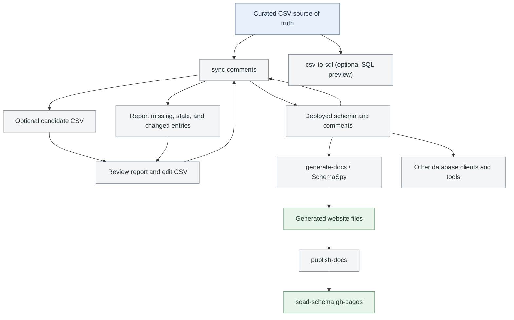
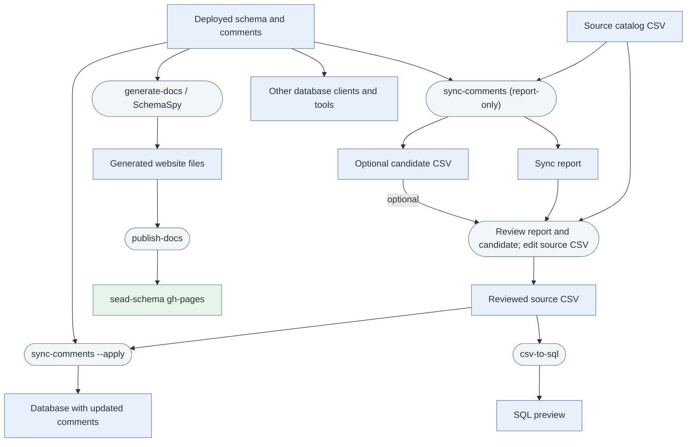

# SEAD database comments and documentation

Table and column descriptions are maintained in [`resources/tables_and_columns.csv`](../../resources/tables_and_columns.csv). The UTF-8, semicolon-delimited CSV is the source of truth; users may edit it with Excel or another editor. The sync tools read the CSV directly and do not require Excel.

The descriptions are also stored as PostgreSQL comments so database clients and documentation tools can consume them. This directory contains scripts and SchemaSpy templates for generating the website at <https://humlab-sead.github.io/sead-schema/>, one such consumer. The `sead-schema` repository contains generated website files, not the source descriptions.

## Workflow

1. Edit and commit changes to `resources/tables_and_columns.csv`.
2. Compare the catalog with a database. The default is report-only:

   ```bash
   ./bin/create-docs/sync-comments \
     --database sead_staging \
     --schema public
   ```

   The report identifies database tables and columns missing from the catalog, including existing database comments that can be copied into proposed catalog rows. It also reports catalog entries absent from the selected database and comments that need updating.

   To write a separate candidate CSV that retains existing catalog rows and adds objects missing from the selected schema, use:

   ```bash
   ./bin/create-docs/sync-comments \
     --database sead_staging \
     --schema public \
     --export-candidate /tmp/tables_and_columns.candidate.csv
   ```

   The command is read-only and refuses to replace an existing file or the source catalog. Existing descriptions are retained; blank descriptions are filled from matching database comments when available. New objects without database comments have blank descriptions. New table rows use the table name as a provisional `entity_name`, which should be reviewed. Existing catalog rows absent from the selected database remain in the candidate for review.
3. Review the report and candidate CSV, then update the source CSV manually. The sync script does not edit the source-of-truth. Blank comments are allowed while descriptions are being curated.
4. Apply nonblank descriptions from the CSV to existing database objects:

   ```bash
   ./bin/create-docs/sync-comments \
     --database sead_staging \
     --schema public \
     --apply
   ```

   The script changes comments only. It skips blank catalog comments and does not create database objects, remove comments, or delete stale catalog rows. Schema changes remain part of the normal Sqitch workflow. The existing [`SEAD_MODEL_COMMENTS`](../../sead_model/deploy/SEAD_MODEL_COMMENTS/) change is historical deployment content, not a file to regenerate for each catalog edit.
5. Generate and inspect the SchemaSpy site, then publish it as a separate step:

   ```bash
   output_dir="$(mktemp -d /tmp/sead-schema.XXXXXX)"
   ./bin/create-docs/generate-docs sead_staging public --target-folder "$output_dir"
   ```

   If the generated site looks correct:

   ```bash
   ./bin/create-docs/publish-docs "$output_dir" --force
   ```

   Publishing force-updates the `gh-pages` branch of `humlab-sead/sead-schema`; use `--force` only when you intend to replace its current contents.



### Alternative action-centered flowchart

This view places each action between the artifacts it reads and produces.



## Script reference

### `sync-comments`

Compares the CSV with tables, views, and columns in the selected database schema. It reports:

- Database objects missing from the CSV. If an object has a database comment, the report shows proposed CSV fields; a table proposal needs an `entity_name` display label.
- Catalog entries whose objects do not exist in the selected database, for review as stale or unavailable.
- Existing objects whose database comments are missing or differ from the CSV.
- Catalog entries with blank comments. If the database has a comment, the report shows it as a value to review.

By default, the script performs read-only checks. `--apply` updates only nonblank comments for catalog entries whose objects exist. It does not update the CSV automatically. Blank comments are skipped by both `--apply` and `csv-to-sql`.

Use `--export-candidate PATH` to write a separate CSV in the source format. It retains existing catalog rows, fills blank comments from matching database comments when available, and appends tables and columns missing from the catalog for the selected schema. New rows without database comments have blank comments. New table rows use the table name as a provisional `entity_name`; review this label before copying candidate data into the source catalog. The option never updates the database, refuses to overwrite an existing file, and cannot target the source catalog itself. It cannot be combined with `--apply`.

Use `--excludes FILENAME` to omit matching objects from the report and `--apply`:

```bash
./bin/create-docs/sync-comments \
  --database sead_staging \
  --schema public \
  --excludes /path/to/excludes.txt
```

For example, `excludes.txt` could contain:

```text
*.date_updated
tbl_isotopes*
view_*
```

The file contains one expression per line; blank lines are ignored. Each expression is `<table-expr>` or `<table-expr>.<column-expr>`. `*` is the only supported wildcard, and matching is case-sensitive. A table-only expression excludes the table and all its columns. A table-and-column expression excludes only matching columns. For example, `*.date_updated` excludes that column from every table, while `tbl_isotopes*` excludes matching tables and their columns. Other glob metacharacters such as `?` and `[]` are rejected. During candidate export, existing source rows are retained, but excluded database objects are not added or used to fill blank comments.

The positional catalog path is optional and defaults to `resources/tables_and_columns.csv`. Use `--host`, `--port`, and `--user` to override connection settings. Otherwise, connection values come from the repository-root `.env`, PostgreSQL environment variables, and local vault defaults; use `.pgpass` or `PGPASSWORD` for authentication. The database is required and the schema defaults to `public`. Python 3 and `psql` must be available.

### `csv-to-sql`

Exports the CSV as safely quoted PostgreSQL `COMMENT` statements to standard output. It does not connect to or change a database:

```bash
./bin/create-docs/csv-to-sql resources/tables_and_columns.csv > /tmp/sead-comments.sql
```

The optional catalog path defaults to `resources/tables_and_columns.csv`. Add `--schema public` to export one schema only.

### `generate-docs`

Runs SchemaSpy against the selected database and writes generated files to a new or empty target directory. It does not publish the site:

```bash
./bin/create-docs/generate-docs sead_staging public --target-folder /tmp/sead-schema-site
```

The script uses the Docker Hub `docker.io/schemaspy/schemaspy:latest` image with Podman by default. Podman pulls the image if it is not already present. Set `SCHEMASPY_IMAGE` to use another image. Podman and the Java `jar` command must be available. The script reads optional repository-root `.env` settings and local vault defaults for the database connection. For authentication, `PGPASSWORD` takes precedence; otherwise the script uses a matching entry from `PGPASSFILE` or `~/.pgpass`, then falls back to the local vault password. The password is stored in a private temporary SchemaSpy properties file, and a `.pgpass` file must not be accessible by group or others.

### `publish-docs`

Publishes an already-generated site containing `index.html` to GitHub Pages. It requires `ghp-import` and push access to the repository. Publishing is separate from generation so the output can be inspected first.
